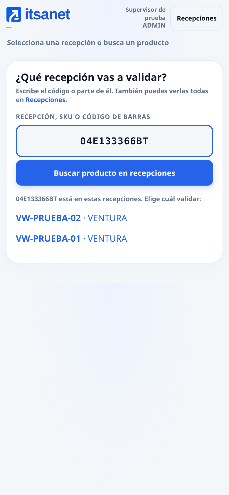
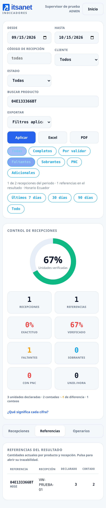
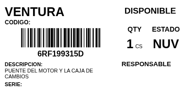

# Configurar Google, etiquetas y cargas Depot

Los datos operativos permanecen en MySQL. Drive conserva archivos y evidencia;
Sheets solo se crea si se solicita como exportación. Los secretos se ingresan
en ADMIN y en propiedades privadas de Apps Script, nunca en Git ni en el chat.

## Aplicar esta actualización al servidor

Las nuevas mejoras se prueban primero en `desarrollo-local`, puerto 3003.
Seguir [la guía de desarrollo](INGRESO_EVIDENCIAS_E_IMPRESION.md); los comandos
siguientes corresponden a la rama operativa y no despliegan esas mejoras.
Para OAuth en desarrollo registrar `http://localhost:3003/api/auth/google/callback`.

En la terminal SSH de VS Code, no en un PowerShell desconectado del servidor:

```bash
cd ~/bryan/IV_ITSANET &&
git pull --ff-only origin pr_bep/serene-thompson-10qlxd &&
.venv/bin/python -m pip install -r requirements.txt &&
sudo systemctl restart iv-itsanet
curl --retry 8 --retry-connrefused --retry-delay 1 --max-time 5 -fsS \
  http://127.0.0.1:3002/health
```

Pillow se incorpora para insertar el logo en Excel. Se instala dentro de la
`.venv` de este proyecto. No se cambia MySQL, el servicio, el archivo SQL local
ni los puertos de otros proyectos. Recargar `/app/` con Ctrl+F5.

## Drive y correo desde la cuenta del supervisor

ADMIN configura las conexiones una sola vez. El supervisor no ve las claves,
rutas, OAuth ni errores técnicos. Al finalizar, el remitente es el supervisor
autenticado: **solo se eligen los destinatarios**, con los últimos grupos usados
para ese mismo cliente. Se pueden corregir antes de confirmar. Si todavía no
hay envíos anteriores, se escriben por primera vez. Dejar vacío archiva sin correo.
La recepción muestra **Entrega del informe → Actualizar estado**: pendiente no
significa enviado. ADMIN conserva el diagnóstico y el reintento en Administración.
El resumen y las diferencias del correo se calculan de la instantánea SQL del
cierre, junto con los packing lists finales y el enlace a las evidencias en Drive.

| Campo | De dónde sale | Cuándo se necesita |
| --- | --- | --- |
| Usuario / clave Depot | Cuenta WMS de ese cliente; la misma configurada en Clientes.gs | Consulta y sincronización con Depot |
| Apps Script `/exec` | Implementar → Aplicación web, desde la cuenta del supervisor | Drive y correo de ese supervisor |
| `SERVIDOR_HMAC` | Clave aleatoria generada por ADMIN; se copia en Apps Script y en el panel | Autenticar el servidor ante el puente |
| Client ID / Client secret | Google Cloud → Google Auth Platform → Clients → cliente web | Solo para el botón «Entrar con Google» |
| URI de redirección | Dirección de la app + `/api/auth/google/callback`; se registra exactamente igual en Google | Solo para el botón «Entrar con Google» |

**Para contar en móviles por WiFi no hacen falta los campos OAuth**: funciona
el correo/usuario y la contraseña local. No se escribe la contraseña de Gmail.
Para «Entrar con Google» desde un móvil sí hace falta un dominio HTTPS autorizado;
`localhost` en el teléfono apunta al propio teléfono. Para enviar desde el Gmail
real del supervisor, esa cuenta debe autorizar el puente una vez; iniciar sesión
en esta app no concede permiso para enviar correo en su nombre.

**MailApp envía como la cuenta que ejecuta el despliegue**, no como la persona
escrita en el cuerpo del mensaje. `replyTo` tampoco cambia el remitente.
Por eso se configura un puente por supervisor. No hace falta una contraseña
de Gmail, una contraseña de aplicación ni una clave de API de Drive.

1. El supervisor abre [Apps Script](https://script.google.com/home) con **su
   cuenta Google**, crea un proyecto independiente y copia estos tres archivos:
   `apps-script/proxy/Proxy.gs` como `Código.gs`, `Clientes.gs` y `Servidor.gs`.
   No pegar `apps-script/src`, que corresponde al aplicativo anterior en Sheets.
   El puente local entra por HMAC antes de cualquier autenticación Firebase.
   Crear un proyecto por supervisor evita cambiar el despliegue operativo actual.
2. Crear una carpeta de evidencias en Drive o usar la carpeta existente.
   Compartirla con cada supervisor como editor y con el ejecutivo como lector
   según la política de la empresa. No publicar imágenes para cualquiera.
   Copiar el ID de `https://drive.google.com/drive/folders/ID_DE_LA_CARPETA`.
3. Generar una clave aleatoria en la terminal SSH:

   ```bash
   python3 -c 'import secrets; print(secrets.token_urlsafe(48))'
   ```

   Copiarla directamente entre los dos paneles privados. Cada puente nuevo debe
   tener su propia clave. El campo no es un código de autorización de Google.
4. En Apps Script → **Configuración del proyecto** (engranaje) →
   **Propiedades del script**, agregar:

   | Propiedad | Valor |
   | --- | --- |
   | `CARPETA_EVIDENCIAS` | ID o enlace de la carpeta Drive compartida |
   | `SERVIDOR_HMAC` | Clave aleatoria del paso anterior, mínimo 32 caracteres |

5. **Implementar → Nueva implementación → Aplicación web**.
   En **Ejecutar como**, elegir **Yo**, comprobando que sea el supervisor.
   Acceso: **Cualquier usuario** para permitir el POST del servidor con firma
   HMAC. El servicio no acepta entregas sin firma válida. Si la organización
   impide este tipo de despliegue, el administrador de Workspace debe habilitar
   un método permitido; no usar una sesión de navegador como credencial del worker.
   Autorizar Drive, envío de correo y acceso al correo de la cuenta ejecutora.
   La exportación opcional a Sheets puede pedir además permiso de hojas.
   Si el manifiesto fija scopes manualmente, incluir
   `https://www.googleapis.com/auth/userinfo.email`, además de Drive y
   `https://www.googleapis.com/auth/script.send_mail`.
6. Copiar la **URL de la aplicación web terminada en `/exec`**. No usar `/dev`,
   el ID del proyecto, la URL del editor ni el enlace de un Sheet.
7. En la app → Administración → **Drive y envío de correo**, ingresar:
   correo exacto del supervisor, URL `/exec` y la misma `SERVIDOR_HMAC`.
   **Guardar puente → Verificar remitente y Drive**. Esta prueba no envía correo.
8. Repetir con cada supervisor. Al cerrar, el servidor toma el responsable de
   su sesión autenticada, selecciona su puente y verifica que la cuenta ejecutora
   coincida antes de subir archivos. No acepta un remitente elegido por el navegador.

La verificación actual devuelve el nombre y un enlace a la carpeta raíz configurada
en `CARPETA_EVIDENCIAS`; comprobar que es la carpeta de la empresa elegida.
Una clave HMAC generada en la terminal no crea ni selecciona una carpeta: debe
registrarse junto con el ID de Drive en las propiedades del script.
Actualizar `Servidor.gs` y **Implementar → Gestionar implementaciones → Editar →
Nueva versión** para incorporar estos enlaces. La galería muestra la ubicación
local antes del cierre y la carpeta de imágenes después de confirmar Drive.

El correo del perfil local debe ser el de la cuenta Google que ejecuta ese
puente. ADMIN puede administrar la conexión; no puede hacer que un despliegue
de otra cuenta envíe como el supervisor. El login Google no concede permisos
para enviar Gmail: son dos configuraciones independientes.

Si ya había un puente global, se conserva como alternativa, pero también debe
superar la verificación de remitente. Actualizar su `Servidor.gs` y publicar una
**nueva versión del despliegue** antes de usarlo con esta actualización.
No basta con guardar el archivo. Los conteos y cierres se conservan mientras
se completa la configuración; los archivos siguen locales hasta confirmar Drive.
Una entrega con confirmación de correo interrumpida continúa requiriendo revisión
para evitar un segundo envío. No se desactiva Firebase automáticamente.

Conservar `VAL_DATA_DIR/secretos/integraciones.key` en los respaldos junto con
MySQL; permite descifrar las credenciales guardadas en `app_config`.

## Diagnosticar el aviso genérico de Google

Si aparece «Google no confirmó la operación», conservar la clave mientras se
identifica la causa. Ese mensaje no demuestra que la carpeta ni los permisos de
Google estén validados. El puente captura los errores de `doPost`, por lo que
una ejecución marcada como completada tampoco demuestra que la operación haya
terminado correctamente.

1. Abrir el proyecto Apps Script correspondiente a la URL `/exec` de la app,
   con la cuenta **bespinoza@itsanet.com**. Actualizar su archivo `Servidor.gs`
   desde `apps-script/proxy/Servidor.gs` de esta rama y guardar. En Configuración
   del proyecto, activar **Mostrar el archivo de manifiesto appsscript.json**.
   Usar [el manifiesto completo del puente](../apps-script/proxy/appsscript.json):
   incluye identidad, Drive, envío de correo, consultas HTTP de Depot/Firebase
   y la exportación opcional a Sheets. No sustituir los permisos existentes por
   una lista que contenga únicamente `userinfo.email`.
2. En Propiedades del script, la carpeta actual indicada es
   `CARPETA_EVIDENCIAS = 1EOCoI3eNpe9lM1iQvgMgDo7e8_oGCBtY`.
   Mantener `SERVIDOR_HMAC` igual en el proyecto y en la app. Si hay un repositorio
   configurado por cliente/marca, comprobar también su enlace en Administración.
3. En el selector de funciones del editor, elegir **verificarGoogleServidor**
   y pulsar **Ejecutar**. Autorizar los permisos solicitados desde la cuenta
   responsable. La función comienza con
   `ScriptApp.requireAllScopes(ScriptApp.AuthMode.FULL)` para solicitar los
   permisos pendientes antes de consultar `Session.getEffectiveUser`.
   Declarar permisos en el manifiesto no concede el consentimiento: completar
   **Revisar permisos**, seleccionar la cuenta correcta y autorizar los permisos
   solicitados. Si Google interrumpe la ejecución para autorizarlos, volver a
   ejecutar la función después de completar el consentimiento. La función
   consulta la cuenta efectiva, abre la carpeta
   configurada y consulta la cuota de correo. No envía mensajes, no modifica
   archivos y no muestra el valor de HMAC.
4. El registro debe indicar la cuenta correcta, la carpeta y la cuota. Si falla,
   el error comienza con `CUENTA GOOGLE`, `CARPETA DRIVE` o `PERMISO DE CORREO`,
   seguido del motivo de Google. Compartir solo ese mensaje para diagnosticar;
   no copiar claves ni propiedades privadas.
5. Si termina correctamente, actualizar el despliegue existente mediante
   **Implementar → Gestionar implementaciones → Editar → Nueva versión**.
   Confirmar ejecución como el supervisor y que la URL `/exec` guardada en la app
   corresponda a ese despliegue. Si la verificación desde la app sigue fallando
   pese al diagnóstico correcto en el editor, revisar primero esa coincidencia
   y la versión publicada.
6. Repetir **Verificar remitente y Drive** desde Administración y, cuando esté
   confirmado, enviar la prueba autorizada a **brantos102@gmail.com**.

Este diagnóstico comprueba lectura de la carpeta y autorización/cuota de correo;
la subida real se verifica con una evidencia de prueba y permiso de editor en
Drive. Una cuota de cero requiere esperar a su recuperación antes de enviar.
Si la organización bloquea el consentimiento, su administrador de Google
Workspace debe revisar la autorización del proyecto. No revocar la conexión
operativa, borrar el despliegue ni cambiar HMAC para resolver un permiso OAuth.

## De dónde obtener Client ID y Client secret de OAuth

1. Abrir [Google Cloud Console](https://console.cloud.google.com/) y seleccionar
   el proyecto `iv-itsanet`. No borrar ni sustituir el cliente utilizado por Firebase.
2. Ir a **Google Auth Platform**. En **Branding**, completar nombre, soporte
   y contacto. En **Audience**, elegir los usuarios previstos; si es externo
   en modo prueba, agregar como usuarios de prueba los Gmail que participarán.
3. En **Clients → Create client → Web application** crear un cliente para el
   servidor. En la interfaz anterior la ruta es **APIs y servicios →
   Credenciales → Crear credenciales → ID de cliente OAuth**.
4. En **Authorized redirect URIs**, para comprobar por reenvío de VS Code:

   ```text
   http://localhost:3002/api/auth/google/callback
   ```

   Usar exactamente ese origen al abrir la app en el computador. Para la app
   del handheld, registrar un dominio HTTPS autorizado y su callback con la
   misma ruta. Google no permite la IP privada por HTTP como callback web.
5. Google muestra el **Client ID** terminado en `.apps.googleusercontent.com`
   y el **Client secret**. Copiarlos directamente a Administración →
   **Entrar con Google · OAuth**, junto con el callback exacto y estado Activo.
   Si el secreto solo se muestra al crear, guardarlo de forma privada; no
   adjuntar el JSON de credenciales al repositorio.
6. Probar con una cuenta autorizada. Las cuentas nuevas quedan pendientes de
   aprobación local; Google no asigna rol ADMIN. Solo se piden identidad,
   correo y perfil. No habilitar Gmail API ni Drive API para este login.

Mientras no exista dominio HTTPS para móviles, el correo/usuario y la contraseña
**de esta app** permiten operar por la red interna. No escribir la clave de Gmail
en el formulario de contraseña local.

## Etiqueta basada en la macro y el stock

La etiqueta de 100 × 50 mm toma estas columnas de `CONSOLIDADO` o `IMPRIMIR`:

| Columna | Campo Excel | Destino de la macro | Etiqueta |
| --- | --- | --- | --- |
| B | `cliente_id` | A2 | Cliente |
| C | `producto_id` | A6 / A9 | Barras y código legible |
| D | `descripcion` | A11 | Descripción |
| E | `nro_serie` | A15 / A17 | Serie; barras si existe |
| G | `nro_despacho` | H5 | Despacho, si existe |
| H | `nro_partida` | H14 | Bajo «RESPONSABLE», como la macro |
| I | `categoria_logica` | H3 | Categoría lógica |
| J | `estado_mercaderia` | J10 | Estado |
| L | `unidad_medida` | I10 | Unidad |
| M | `cantidad` | H10 | Cantidad |

En el archivo entregado: VENTURA, `6RF199315D`, PUENTE DEL MOTOR Y LA CAJA
DE CAMBIOS, DISPONIBLE, cantidad 1, unidad CS, estado NUV; serie y responsable
vacíos. **H es una partida, no el nombre del operario**. No se inventa una
persona ni se reemplaza por quien está conectado. Se puede ajustar el campo
para esa etiqueta. Los asteriscos de la macro son marcadores de una fuente
de barras: no se añaden al SKU; la app genera Code 128 real, legible por escáner.
Una etiqueta PNC muestra CUARENTENA.

En la ficha → **Etiqueta → Tomar datos de stock Excel**, elegir el archivo y
la fila. Es una lectura para la etiqueta; no importa stock ni modifica conteos.
Se imprime cada etiqueta que haga falta; imprimir nunca es requisito de cierre.
La muestra anterior se reemplaza por [la del stock adjunto](muestras/etiqueta-100x50.pdf).

La opción disponible ahora es **escritorio con driver Zebra**, formato existente
10 X 5, escala 100 %, sin márgenes ni encabezados. El handheld permite vista
previa y descarga ZPL, pero no abre impresión directa hacia el driver Windows.
Una PC con la Zebra puede imprimir desde la misma app en la red WiFi.

Para que un handheld envíe trabajos a esa PC haría falta instalar allí un agente
de impresión autenticado, con cola y control de duplicados, y autorizar su canal
HTTPS. El driver instalado por sí solo no crea ese puente. No se instala ni abre
otro puerto en esta entrega: desktop cubre la impresión opcional solicitada.

## Modelos Depot: 18 y 38 columnas

Se revisaron **ambas hojas de cada XLS**. La hoja de definición aporta tipos,
longitudes y obligatoriedad; la hoja `Modelo a Utilizar` determina el encabezado
literal y el orden de salida. Las notas de ambos libros piden **CSV delimitado
por coma**. No se copian DPW, códigos de muestra ni ubicaciones de ejemplo.

Administración conserva los formatos guardados. Para adoptar los adjuntos,
en cada formato pulsar **Aplicar modelo oficial** y luego **Guardar los formatos**.
Se mantienen edición de encabezados, columnas, mapeos y separador; se agregan
valores por defecto y campos obligatorios. Para estado y categoría se pueden
definir valores separados para PNC; no se exporta PNC como DISPONIBLE por defecto.

**Cantidades:** una fila por producto, ubicación, pallet y atributos; series
distintas no se suman. Solo se usan conteos vigentes. La unidad y familia se
consultan al maestro MySQL del cliente; lo desconocido se deja pendiente.
**Productos:** los adicionales detectados físicamente. País, familia, subfamilia,
unidades y códigos de catálogo deben confirmarse con Depot, no inferirse del ejemplo.
Las opciones binarias no se activan copiando valores de una fila ajena.

La descarga Excel contiene únicamente `Modelo a Utilizar`. Si falta un
obligatorio, excede la longitud o el tipo/fecha es inválido, se permite el
**Excel para completar**, con comentarios en las celdas, y se bloquea el CSV
de carga incompleto. Completarlo y guardar esa hoja como CSV delimitado por coma,
o corregir los valores/mapeos en ADMIN y volver a exportar.

## Validar y dashboard

Sin recepción seleccionada se muestran las abiertas; el escáner de conteo se
oculta. Se puede buscar un SKU o EAN entre los packing lists abiertos y elegir
la recepción. Consultar no registra unidades. Cacería mantiene guardado explícito.
La pestaña se llama **Recepción actual**. El logo ITSANET lleva a Inicio.

El dashboard permite fechas (horario Ecuador), cliente, estado, recepción,
producto/descripción y etiquetas Completos, Por validar, Faltantes, Sobrantes,
PNC y Adicionales. Un pendiente no se etiqueta como faltante ya revisado.
Las cifras y los eventos se recortan al mismo conjunto de referencias.
Excel y PDF incluyen logo y el alcance aplicado. **Total del periodo** omite los
filtros adicionales pero conserva las fechas elegidas; no se trunca a las primeras
200 recepciones. El Excel de una vista está limitado a 20.000 filas y rechaza
una exportación mayor explícitamente, sin entregar un archivo recortado.

## Corrección de conexión Depot

El registro empresarial del 15 de octubre confirmó un fallo adicional:
`UnicodeEncodeError` en `getstock`, por `U+FEFF` al comienzo del token.
Depot respondió con un marcador BOM que Python `strip()` conservaba; httpx
intentaba codificarlo como ASCII al armar la cabecera y devolvía 500 antes de
consultar stock. Ahora se retira el BOM tanto de la respuesta como del valor
del token, en texto, cadena JSON y objeto JSON. No se cambian las credenciales.
Una página HTML ya no se interpreta como un token. También se admiten valores
UTF-8 en las cabeceras y se conservan las restricciones de redirección.

Si aparece otro error interno, ADMIN verá el paso y una referencia. Buscarla en
`sudo journalctl -u iv-itsanet -n 60 --no-pager`: se registran clase de excepción
y archivo/línea, sin mensajes que puedan incluir credenciales ni cuerpos HTTP.

`Clientes.gs`, que funciona en Firebase, pide `GET /gettoken` con las cabeceras
**userid / password**. El servidor usaba los nombres antiguos usuario / clave;
se corrigió en `5d657a7`. El inventario usa `GET /getstock` con cabecera `token`.
La URL base debe ser la raíz, por ejemplo `https://ec.itsanet.com/q_apidepot`;
se recorta `/gettoken` o `/getstock` si se pegó un endpoint.

El botón **Probar** verifica autenticación y lectura de stock por separado,
mostrando filas y clientes sin devolver el token. Después sincronizar el catálogo
en Recepciones. Un fallo de DNS, TLS o salida de red del servidor puede persistir
aunque Apps Script conecte desde Google; el panel lo distingue de la fase stock.
Esta sesión no tiene las credenciales empresariales ni acceso SSH para certificar
esa conexión real; no se cambian contraseñas para corregir nombres de cabecera.

## Muestras verificadas

Datos sintéticos para revisar la interfaz:






La etiqueta PDF tiene una página y se leyó digitalmente el código `6RF199315D`
a 203 dpi. La impresión física y el envío real de correo requieren comprobación
en la empresa. El navegador verificó búsqueda sin conteos nuevos, logo a Inicio,
impresión deshabilitada en handheld, filtros y Excel/PDF coincidentes.
