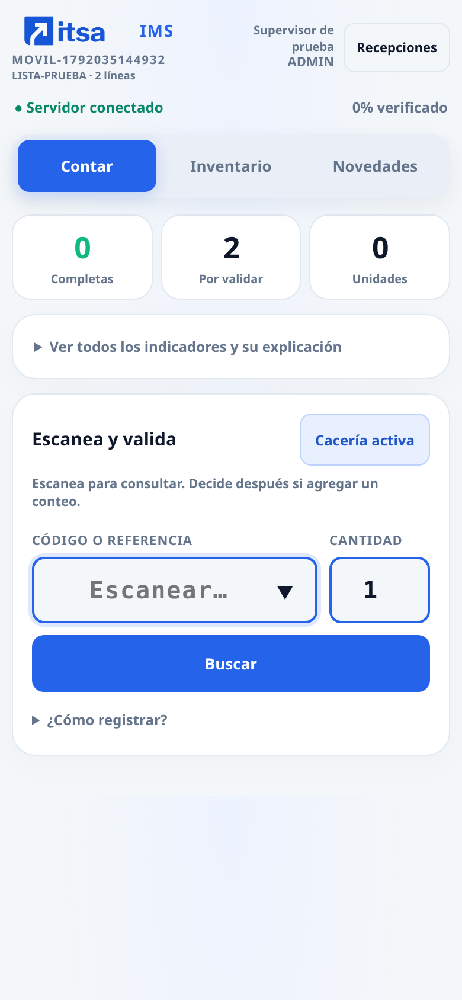
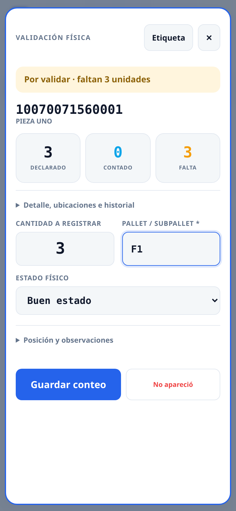

# Validacion movil y conexiones del servidor

Se conserva la aplicacion, los packing lists, conteos, aprobaciones y archivos.
Esta actualizacion no importa historicos, no cambia el servicio ni el puerto
3002 y no modifica el archivo local `mysql/01-crear-base.sql`.

## Muestra para revision

Datos sinteticos, sin operaciones empresariales. Izquierda: escaner y resumen.
Derecha: ficha para registrar, con informacion secundaria plegable.




[Etiqueta PDF para probar la Zebra](muestras/etiqueta-100x50.pdf) ·
[Archivo ZPL de muestra](muestras/etiqueta-zebra.zpl)


## Actualizar desde VS Code por SSH

```bash
cd ~/bryan/IV_ITSANET
git status --short
git pull --ff-only origin pr_bep/serene-thompson-10qlxd
sudo systemctl restart iv-itsanet
curl --retry 8 --retry-connrefused --retry-delay 1 --max-time 5 -fsS \
  http://127.0.0.1:3002/health
```

Conservar cambios locales. No ejecutar `git reset --hard`, no reinstalar el
servicio ni ejecutar scripts de creacion de otra base. No se requiere npm en
el servidor: se incluyen las bibliotecas del navegador. No hay dependencias
Python nuevas; Fernet utiliza cryptography, ya requerido por PyMySQL[rsa].

Abrir `/app/` y recargar con Ctrl+F5. En el computador con reenvio SSH,
`http://localhost:3002/app/`. En el movil conectado a la red de la empresa,
`http://192.168.4.94:3002/app/`.

## Acceso y recepciones recientes

El registro acepta correo corporativo o Gmail y una contrasena **de esta app**.
No usar la contrasena de Gmail en ese formulario. Las cuentas nuevas siguen
inactivas hasta que un supervisor las apruebe en Usuarios.

El servidor acepta usuario o correo en el acceso local. Se corrigio la llamada
al SDK Firebase con sesion nula al abrir la pagina; el retorno OAuth local ya
no ejecuta `getRedirectResult(auth)` de Firebase. Los errores de validacion del
formulario ahora muestran su mensaje especifico.

Las fechas ISO de MySQL y los Timestamp de Firestore usan el mismo filtro de
15 dias. El inicio permite buscar y actualizar el listado. Este filtro no
borra ni cierra recepciones antiguas; siguen disponibles en Recepciones.

## Conexiones: solo ADMIN

Administracion → **Conexiones del servidor** permite:

- Agregar o editar clientes Depot, URL de API, usuario y clave; activar o
  desactivar una conexion y probar la autenticacion sin revelar el token.
- Configurar URL y clave compartida del puente Drive/correo.
- Configurar el cliente OAuth de «Entrar con Google».

Los endpoints verifican ADMIN en el servidor; ocultar botones no es la barrera
de seguridad. Operadores y supervisores reciben 403 al intentar configurar o
probar credenciales. Los campos secretos vacios conservan lo guardado. Las
respuestas nunca devuelven contrasenas, claves compartidas ni client secrets.

Las credenciales se cifran en `app_config`. La clave privada vive en
`VAL_DATA_DIR/secretos/integraciones.key`, con permisos 600 y directorio 700.
Conservar ese archivo junto con el respaldo de la base, fuera de Git y del
chat: sin el no se pueden recuperar las credenciales cifradas.

Las conexiones existentes de `/etc/iv-itsanet.env` siguen como alternativa
cuando no hay configuracion en la interfaz. Una configuracion guardada en el
panel prevalece sobre las variables correspondientes; no requiere reiniciar.
Los valores de Apps Script no se copian automaticamente: ADMIN debe ingresarlos
en el nuevo panel. No se modifica el Apps Script de otros proyectos.

Despues de configurar, **Recepciones → Descargar catalogo** sincroniza los
clientes activos contra el espejo MySQL. Si un SKU pertenece a otro cliente,
se conserva su propietario original y se avisa del conflicto; no se mezcla
silenciosamente el catalogo. El conteo mantiene el espejo local cuando el WMS
no responde. La conexion real a cada WMS se comprueba con su boton Probar y una
sincronizacion usando las credenciales empresariales.

## Activar «Entrar con Google» sin Firebase

Este flujo OAuth funciona directamente entre Google y el servidor. La sesion,
la ficha, los roles y la aprobacion permanecen en MySQL. Un correo Google
verificado enlaza la ficha local del mismo correo; una cuenta nueva se crea
como OPERADOR pendiente de aprobacion, nunca como administrador.

1. En Google Cloud, proyecto `iv-itsanet`, crear un **cliente OAuth de tipo
   Aplicacion web** para el servidor. No reemplazar el cliente que usa Firebase.
2. Configurar la pantalla de consentimiento para los usuarios previstos. Si
   esta en modo de prueba, agregar sus correos como usuarios de prueba. Se
   solicitan solo identidad, correo y perfil.
3. Para comprobarlo desde el computador con el puerto reenviado de VS Code,
   autorizar exactamente este URI de redireccion:

   `http://localhost:3002/api/auth/google/callback`

4. En Administracion → Entrar con Google, guardar Client ID, Client secret y
   ese mismo callback. Los valores se ingresan **en el panel**, no en el chat.
   Abrir la app por `http://localhost:3002/app/` para esa prueba.
5. Para los handhelds, configurar un **nombre de dominio HTTPS autorizado**
   accesible desde su red, y registrar su callback terminado en
   `/api/auth/google/callback`. El acceso actual por IP privada y HTTP no es un
   callback OAuth permitido por Google. Hasta disponer de esa direccion,
   el movil puede operar con correo/usuario y contrasena local.

El boton indica configuracion pendiente o direccion no autorizada en lugar de
intentar iniciar Firebase y fallar con `Cannot read properties of null`.
El retorno usa PKCE y estado cifrado con caducidad; las cookies de acceso HTTPS
son Secure y HttpOnly. El servidor intercambia el codigo de un solo uso y
consulta UserInfo a Google sobre TLS; rechaza correos no verificados.

## Revisar y aceptar la vista movil

En Chrome del computador: F12 → Ctrl+Shift+M → dispositivo Responsive →
**390 × 844**. Abrir una recepcion de prueba en `/app/validar.html?r=CODIGO`.
Tambien comprobar directamente en un handheld de la red.

1. **Contar:** muestra tres cifras, estado de conexion y entrada de codigo.
   El resto de indicadores y sus explicaciones estan plegados, no eliminados.
2. **Caceria activa:** escanear consulta el estado actual en el servidor. No
   crea un conteo. La ficha muestra declarado, contado y faltante. Un codigo
   ya validado se puede consultar sin sumar otra vez.
3. Elegir **Contar este producto** o **Agregar otro conteo**, indicar cantidad
   y pallet y pulsar **Guardar conteo**. La cantidad inicial es 1, no todo lo
   que falta. Se respeta una cantidad indicada antes del escaneo.
4. **Conteo directo:** desactivar Caceria abre directamente los campos. Guardar
   sigue siendo explicito; se conservan confirmacion de sobrantes e idempotencia.
5. Posicion, observaciones, ubicaciones e historial estan disponibles al
   desplegarlos. PNC abre observaciones y mantiene captura de fotos; DP abre
   la posicion real. No aparecio sigue exigiendo nota y confirmacion.
6. **Inventario:** referencias en tarjetas para movil, filtros y etiquetas.
   **Novedades:** recorta las referencias revisadas con diferencias o PNC.
   Las referencias pendientes siguen visibles en Inventario.
7. El supervisor finaliza o exporta desde Inventario. El cierre y la entrega
   conservan los estados pendientes y reintentos de la version anterior.

## Zebra ZD421-203dpi ZPL · formato existente 10 X 5

La etiqueta conserva cliente, codigo Code 128, descripcion y serie a la
izquierda; DISPONIBLE, QTY/CS, ESTADO NUV y RESPONSABLE a la derecha. Para PNC
muestra CUARENTENA. Cantidad, estado, serie y responsable se pueden ajustar
para esa etiqueta; no modifican los conteos ya registrados.

El acceso **Imprimir etiqueta** aparece despues de guardar. Tambien esta en
la ficha y en cada referencia de Inventario. La vista previa permite imprimir
con el controlador Windows o descargar ZPL. El ZPL usa 800 × 400 puntos para
la Zebra de 8 puntos/mm (203 dpi). Los datos se codifican como campos, evitando
que el contenido se interprete como comandos ZPL.

Para la prueba fisica desde Windows:

1. Elegir **ZDesigner ZD421-203dpi ZPL** y el formato existente **10 X 5**.
2. Escala **100 % / tamano real**, una pagina por hoja, margenes ninguno y
   encabezados/pies desactivados. No usar Ajustar a pagina.
3. Imprimir la muestra y comprobar medida, lectura del codigo y todos los
   campos. El PDF de muestra tiene una sola pagina; se verifico digitalmente
   la lectura del codigo al renderizarlo a 203 dpi.

Descargar ZPL no lo envia automaticamente a la impresora: requiere el canal
ZPL ya configurado en Windows/Zebra. No se modifica el controlador ni se
buscan dispositivos en la red. El movil permite revisar y descargar; imprimir
fisicamente requiere el equipo o servicio que tenga acceso a la Zebra.

## Estado de verificacion y retirada de Firebase

Se probaron contratos y permisos en SQLite y en un MySQL 8.4 aislado, junto con
el flujo de navegador movil y la etiqueta. OAuth se probo con respuestas de
Google simuladas; su activacion real necesita el cliente y URI del propietario.
No se enviaron correos reales ni se imprimio en la Zebra fisica desde esta sesion.

La actualizacion se entrega en GitHub. El servidor empresarial necesita pull y
reinicio. Antes de desactivar Firebase, comprobar una recepcion nueva, usuario
aprobado, foto, informe, acceso compartido a Drive y correo recibido. La guia de
ese puente y de la retirada de Hosting esta en [OPERACION_LOCAL.md](OPERACION_LOCAL.md).
